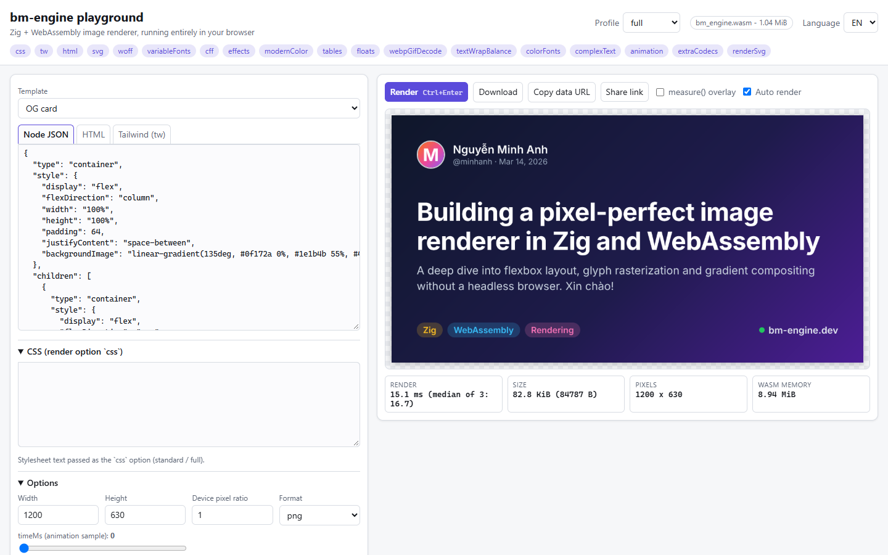

# Playground

[English](playground.md) · [Tiếng Việt](../vi/playground.md)

The repository contains a static, framework-free playground (`playground/`: plain HTML, ES modules and
CSS; no build step for development and no external requests) that runs bm-engine in the browser. Use it
to try node JSON, HTML and Tailwind input, compare the three profiles and inspect layout. This page
summarises [playground/README.md](../../playground/README.md).



## Features

- Profile selector (`core` / `standard` / `full`); switching reloads the page with
  `?profile=core|standard|full` because each page keeps one wasm instance. Your source, options and
  images are restored from `localStorage`.
- Inputs: node JSON, HTML, Tailwind; the `css` option; font and image upload.
- Outputs: PNG, JPEG, WebP, raw, SVG (`renderSvg`) and animated WebP / APNG / GIF, with render timing,
  download and "copy data URL".
- `measure()` overlay, templates (OG card, blog card, Vietnamese text, emoji, SVG image, HTML article,
  Tailwind card, CSS demo, animation, gradients, table + float), English / Vietnamese UI.
- **Share link** puts the deflate-compressed state into the URL hash.

Templates that need a feature the selected profile lacks show a clear message or render in a degraded
way (for example the Tailwind card on `core`), which makes the playground a quick way to see what each
profile drops.

## Run locally

From a repository checkout with the `js/*.wasm` binaries present (prebuilt in the repository, or
`node scripts/build.mjs`):

```sh
npm run playground                       # = node playground/serve.mjs -> http://127.0.0.1:8080/playground/
node playground/serve.mjs --port 3000
node playground/build.mjs && node playground/serve.mjs --dist   # the self-contained build in playground/dist/
```

The development page loads the engine from `../js/` and fonts from `../assets/fonts/`; the `dist` build
copies them into `vendor/`. Both layouts are described in `playground/config.js` (`build.mjs` writes a
different `dist/config.js`). The server sends `.wasm` files as `application/wasm`.

Automated test: `node bench/browser/playground-test.mjs` (headless Edge / Chrome via puppeteer-core;
writes `playground/screenshots/*.png` and `bench/out/PLAYGROUND.md`). The last recorded run passed on
all three profiles.

## Deploy to GitHub Pages

1. `node playground/build.mjs` creates `playground/dist/` (HTML / JS / CSS, `vendor/` with `js/*.mjs`,
   the `.wasm` files and the default fonts, plus `.nojekyll`). The `js/*.wasm` files must exist.
2. Copy `playground/pages.yml.example` to `.github/workflows/pages.yml`, set **Settings → Pages →
   Source** to "GitHub Actions" and push to `main`. The workflow runs `node playground/build.mjs` and
   publishes `playground/dist` with `actions/upload-pages-artifact` + `actions/deploy-pages`.
3. Alternatively, publish the contents of `playground/dist/` to a `gh-pages` branch by hand.

`playground/dist` is a plain static site, so any static host works the same way, provided it serves
`.wasm` with the `application/wasm` content type (other types still work, without streaming
compilation).
