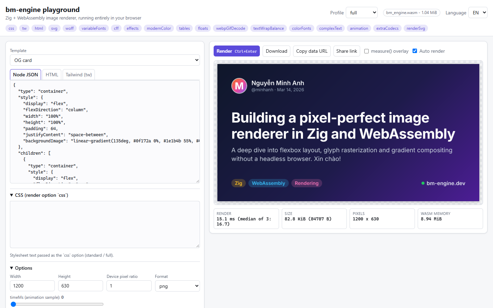

# Playground

[English](../en/playground.md) · [Tiếng Việt](playground.md)

Repository có kèm một playground tĩnh, không dùng framework (`playground/`: HTML, ES module và CSS thuần;
không cần bước build khi phát triển và không gọi ra mạng ngoài) để chạy bm-engine ngay trong trình duyệt.
Dùng nó để thử đầu vào node JSON, HTML và Tailwind, so sánh ba profile và xem layout. Trang này tóm tắt
[playground/README.md](../../playground/README.md).



## Tính năng

- Chọn profile (`core` / `standard` / `full`); khi đổi, trang được tải lại với
  `?profile=core|standard|full` vì mỗi trang chỉ giữ một instance wasm. Mã nguồn, tùy chọn và ảnh đang
  soạn được khôi phục từ `localStorage`.
- Đầu vào: node JSON, HTML, Tailwind; tùy chọn `css`; tải font và ảnh lên.
- Đầu ra: PNG, JPEG, WebP, raw, SVG (`renderSvg`) và WebP / APNG / GIF động, kèm thời gian render, tải
  xuống và "sao chép data URL".
- Lớp phủ `measure()`, các mẫu có sẵn (thẻ OG, thẻ blog, chữ tiếng Việt, emoji, ảnh SVG, bài viết HTML,
  thẻ Tailwind, demo CSS, animation, gradient, bảng + float), giao diện tiếng Anh / tiếng Việt.
- **Share link** đặt trạng thái (đã nén deflate) vào hash của URL.

Những mẫu cần tính năng mà profile đang chọn không có sẽ hiện thông báo rõ ràng hoặc render ở dạng giản
lược (ví dụ thẻ Tailwind trên `core`), nên playground là cách nhanh để thấy mỗi profile bỏ đi những gì.

## Chạy cục bộ

Từ một bản checkout của repository có sẵn các binary `js/*.wasm` (đã build sẵn trong repository, hoặc
chạy `node scripts/build.mjs`):

```sh
npm run playground                       # = node playground/serve.mjs -> http://127.0.0.1:8080/playground/
node playground/serve.mjs --port 3000
node playground/build.mjs && node playground/serve.mjs --dist   # the self-contained build in playground/dist/
```

Trang phát triển nạp engine từ `../js/` và font từ `../assets/fonts/`; bản build `dist` chép chúng vào
`vendor/`. Cả hai cách bố trí được mô tả trong `playground/config.js` (`build.mjs` ghi ra một
`dist/config.js` khác). Server gửi file `.wasm` với content type `application/wasm`.

Kiểm thử tự động: `node bench/browser/playground-test.mjs` (Edge / Chrome headless qua puppeteer-core;
ghi `playground/screenshots/*.png` và `bench/out/PLAYGROUND.md`). Lần chạy được ghi nhận gần nhất đã đạt
trên cả ba profile.

## Triển khai lên GitHub Pages

1. `node playground/build.mjs` tạo `playground/dist/` (HTML / JS / CSS, `vendor/` chứa `js/*.mjs`, các
   file `.wasm` và font mặc định, cùng `.nojekyll`). Các file `js/*.wasm` phải tồn tại sẵn.
2. Chép `playground/pages.yml.example` thành `.github/workflows/pages.yml`, đặt **Settings → Pages →
   Source** thành "GitHub Actions" rồi push lên `main`. Workflow chạy `node playground/build.mjs` và
   xuất bản `playground/dist` bằng `actions/upload-pages-artifact` + `actions/deploy-pages`.
3. Hoặc tự đẩy nội dung `playground/dist/` lên nhánh `gh-pages`.

`playground/dist` là một trang tĩnh thuần, nên mọi dịch vụ host tĩnh đều dùng được theo cùng cách, miễn
là phục vụ `.wasm` với content type `application/wasm` (content type khác vẫn chạy, chỉ là không biên
dịch theo luồng).
